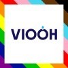
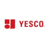

  

# OpenOOH
OpenOOH is a multidisciplinary working group of industry professionals operating in the advertising signage industries, with members representing supply, demand, technology, measurement, and operations functions.

The group is governed and coordinated by the Out of Home Advertising Association of America ([OAAA](https://www.oaaa.org)).

The group authors and publishes open source standards for the data exchanged between the various stakeholders in the advertising signage industries, including Out of Home (OOH), Digital Out of Home (DOOH), Programmatic Digital Out of Home (PrDOOH), in-store retail media, cinema, and other signage contexts in public spaces.

These standards aim to ease collaboration, both within the context of a single campaign and operationally across large networks of signage locations.
# Context
Today, there are over 100 different known data models describing advertising signage, with each stakeholder operating from its own definition of properties and characteristics. The same sign location is described differently in each system it's listed in, and so stakeholders must constantly re-map and reconcile data.

**OpenOOH standards give the industry one shared vocabulary.**
# Benefits
| Stakeholder          | Benefits of using standardised data formats                                                                                                                                                                                                                                                                                              |
| -------------------- | ---------------------------------------------------------------------------------------------------------------------------------------------------------------------------------------------------------------------------------------------------------------------------------------------------------------------------------------- |
| Media Owners         | Simplified syndication of inventory datasets to other stakeholders, including advertisers.  Improved accuracy and consistency in the representation of signage inventory across multiple platforms.  Simplified planning, buying, and analysis for advertiser clients can facilitate and improve sales processes and volume. |
| Advertisers          | More precise discovery, filtering and targeting for campaign delivery locations.  Clear visibility of each location's capabilities and restrictions.  Simplified data analysis, as all signage locations share a common descriptive language.                                                                                |
| Technology Providers | More efficient and consistent machine readability of inventory datasets.  Native data collaboration with other technical platforms.  Removal of ambiguity in property definitions.  Reduced inference within agentic workflows.                                                                                        |
# Published Standards

## `signage-properties` (incorporating `venue-taxonomy`)

The `signage-properties` standard defines various taxonomies and field rules for  the descriptive properties of signage installations. The standard provides structured definitions of the `venue`, `medium`, `shape`, `structure`, `location`, `viewshed`, `operating-hours`, `dimensions`, `media-attachments`, and `identity`.

`venue-taxonomy` is an existing, widely adopted standard from this group that classifies the type of venue a signage face is in. The `signage-properties` standard incorporates and builds on this adopted standard.

# Current Working Group

| Organization                                     | Member                                                                                                                                                                                                                                                                                                                                                                                                              | Role               |
| ------------------------------------------------ | ------------------------------------------------------------------------------------------------------------------------------------------------------------------------------------------------------------------------------------------------------------------------------------------------------------------------------------------------------------------------------------------------------------------- | ------------------ |
|                 | **Robert Loftus** VP Platform Sales [Broadsign](https://www.broadsign.com)                                                                                                                                                                                                                                                                                                                                    | Chair              |
|                         | **Daniel Harkin** Chief Product Officer [Catch](https://www.catch.ad)                                                                                                                                                                                                                                                                                                                                         | Co-Chair Author |
|                           | **Patrick Dolan** Chief Operating Officer [OAAA](https://www.oaaa.org)  **Steve Nicklin** SVP Marketing & Analytics [OAAA](https://www.oaaa.org)  **Stephen Freitas** Executive Advisor [OAAA](https://www.oaaa.org)  **Paul Kultgen** Strategic Growth & Product Innovation [OAAA](https://www.oaaa.org)                                                                 |                    |
|        | **Jason Shao** COO [Place Exchange](https://www.placeexchange.com/)                                                                                                                                                                                                                                                                                                                                           |                    |
|                 | **Ari Buchalter** Chief Strategy Officer [Broadsign](https://www.broadsign.com)  **Joy Hines** Client Success Leader [Broadsign](https://www.broadsign.com)                                                                                                                                                                                                                                       |                    |
|            | **Ian Brecher** Senior Director, Supply Partnerships [Vistar Media](https://www.vistarmedia.com/)  **Ciara Kennedy** SVP Product [Vistar Media](https://www.vistarmedia.com/)  **Eric Justusson** Engineering Leader [Vistar Media](https://www.vistarmedia.com/)  **Christian Collins** VP Product Management [Vistar Media](https://www.vistarmedia.com/)               |                    |
|                         | **Jean-Christophe Conti** CEO [VIOOH](https://www.viooh.com)  **Gavin Wilson** Global Chief Commercial Officer [VIOOH](https://www.viooh.com)  **Ludovic Menard** CPO [VIOOH](https://www.viooh.com)  **Jasleen Kaur** Senior Product Manager [VIOOH](https://www.viooh.com)  **Meritxell Garcia** Senior Product Data Manager [VIOOH](https://www.viooh.com) |                    |
|                       | **Minji Jeong** Director, Supply Integration [Hivestack by Perion](https://www.perion.com/)  **Norm Chait** Vice President, US Marketplace [Hivestack by Perion](https://www.perion.com/)                                                                                                                                                                                                         |                    |
|                     | **Chris Luken** SVP Product [Geopath](https://www.geopath.org)                                                                                                                                                                                                                                                                                                                                                |                    |
|                     | **Katie Burwell** Senior Director, Marketplace Growth & Partnerships [AdQuick](https://www.adquick.com)                                                                                                                                                                                                                                                                                                       |                    |
|             | **Ashton Biggers** Senior Manager, Research & Insights [OUTFRONT Media](https://www.outfront.com)  **Christina Radigan** Chief Research Officer [OUTFRONT Media](https://www.outfront.com)                                                                                                                                                                                                        |                    |
|             | **Cheryl Zimmerman** VP Sales Operations [Lamar Advertising](https://www.lamar.com)                                                                                                                                                                                                                                                                                                                           |                    |
|               | **Joshua Berg** Senior Lead Sales Engineer [StackAdapt](https://www.stackadapt.com/)  **Nick Ortega** Product Strategy & Partnerships [StackAdapt](https://www.stackadapt.com/)  **Jason Pan** [StackAdapt](https://www.stackadapt.com/)                                                                                                                                                 |                    |
|                         | **Eric Kubischta** Chief Technology Officer [Lucit](https://www.lucit.cc/)                                                                                                                                                                                                                                                                                                                                    |                    |
|         | **Drew Jackson** CEO [StreetMetrics](https://www.streetmetrics.io)  **Breeze Dake** Chief Product Officer [StreetMetrics](https://www.streetmetrics.io)                                                                                                                                                                                                                                           |                    |
|                    | **Mike Cooper** CEO [DO Media](https://www.domedia.com)  **Jeff Lamb** CTO [DO Media](https://www.domedia.com)                                                                                                                                                                                                                                                                                    |                    |
|                              | **Chris Cowlbeck** Chief Vision Officer [Independent Billboard Operators](https://www.ibousa.org)                                                                                                                                                                                                                                                                                                             |                    |
|  | **Alyson Metscher** Director, Programmatic Account Management [Clear Channel Outdoor](https://www.clearchanneloutdoor.com)  **Nolan Panno** Director, Research & Insights [Clear Channel Outdoor](https://www.clearchanneloutdoor.com)  **Trisha Dall** VP, Sales Operations [Clear Channel Outdoor](https://www.clearchanneloutdoor.com)                                             |                    |
|                | **Mary Perrella** VP, Sales & Marketing [Vengo Labs](https://www.vengolabs.com)                                                                                                                                                                                                                                                                                                                               |                    |
|                          | **Lee Houghton** Senior OOH Strategist [YESCO](https://www.yesco.com)                                                                                                                                                                                                                                                                                                                                         |                    |
|             | **David Weinfeld** CEO [Screenverse](https://www.screenversemedia.com)                                                                                                                                                                                                                                                                                                                                        |                    |

*All other contributors, past and present, are credited on the respective works.*

# Known Adoption
*To add or update an entry in the adoption tables below, open a GitHub issue on the adopted standard's repository.*

## Programmatic SSPs

| Organization                                     | Platform                                                                                                                | Adoption  |
| ------------------------------------------------ | ----------------------------------------------------------------------------------------------------------------------- | --------- |
|           | [Broadsign Reach](https://docs.broadsign.com/broadsign-reach/en/screens-set-up-inventory-venues.html)                   | venue 1.1 |
|               | [Equativ](https://help.smartadserver.com/articles/Knowledge/OpenRTB-API-for-suppliers-Bid-request-specification-Part-1) | venue 1.0 |
|                 | [Google Ad Manager (Ad Exchange)](https://developers.google.com/authorized-buyers/rtb/openrtb-guide)                    | venue 1.1 |
|                 | [Hivestack by Perion](https://www.hivestack.com)                                                                        | venue 1.2 |
|  | [Place Exchange](https://www.placeexchange.com)                                                                         | venue 1.2 |
|                 | [Stroeer SSP](https://www.stroeer.com)                                                                                  | venue 1.2 |
|                   | [VIOOH](https://www.viooh.com)                                                                                          | venue 1.2 |
|      | [Vistar Media](https://help.vistarmedia.com/hc/en-us/articles/360045661331-Venue-types-in-Vistar-s-SSP)                 | venue 1.2 |

## Exchanges

| Organization                            | Platform                                                                   | Adoption  |
| --------------------------------------- | -------------------------------------------------------------------------- | --------- |
|  | [BidSwitch](https://protocol.bidswitch.com/standards-v57/dooh-object.html) | venue 1.1 |

## Programmatic DSPs

| Organization                                 | Platform                                                                                                           | Adoption  |
| -------------------------------------------- | ------------------------------------------------------------------------------------------------------------------ | --------- |
|             | [Adomni](https://www.adomni.com)                                                                                   | venue 1.2 |
|           | [AdQuick](https://help.adquick.com/en/articles/15961340-how-do-venue-type-controls-work-in-programmatic-campaigns) | venue 1.0 |
|       | [Broadsign Ads](https://broadsign.com)                                                                             | venue 1.2 |
|             | [CAASie.co](https://caasie.co)                                                                                     | venue 1.1 |
|        | [Displayce](https://documentation.displayce.com/venue-types-targeting)                                             | venue 1.1 |
|             | [Hivestack by Perion](https://www.hivestack.com)                                                                   | venue 1.2 |
|         | [OutMoove](https://broadsign.com/outmoove/)                                                                        | venue 1.1 |
|      | [The Neuron](https://www.theneuron.com)                                                                            | venue 1.2 |
|        | [The Trade Desk](https://open.thetradedesk.com/seller/docsApp/GuidesSeller/openpath/doc/StandardAdapter)           | venue 1.1 |
|  | [Vistar Media](https://www.vistarmedia.com)                                                                        | venue 1.2 |
|                | [Yahoo DSP](https://developer.yahoo.com/dsp/api/docs/traffic/targeting/dooh-venue-types.html)                      | venue 1.1 |

## Creative & Campaign Management

| Organization | Platform | Adoption |
| --- | --- | --- |
|  | [Lucit](https://lucit.cc/lucit-announces-support-for-the-openooh-digital-screen-taxonomy-specification/) | venue 1.1 |

## Mobile Engagement & Analytics

| Organization | Platform | Adoption |
| --- | --- | --- |
|  | [Catch](https://www.catch.ad) | venue 1.2 |

## Adoption within other standards

| Organization                         | Standard                                                                                                        | Adoption                |
| ------------------------------------ | --------------------------------------------------------------------------------------------------------------- | ----------------------- |
|  | [OpenRTB v2.6+](https://github.com/InteractiveAdvertisingBureau/openrtb2.x)                                     | venue 1.0, 1.1          |
|  | [AdCOM](https://github.com/InteractiveAdvertisingBureau/AdCOM)                                                  | venue 1.0, 1.1          |
|                | [AdCP (Ad Context Protocol)](https://docs.adcontextprotocol.org/dist/docs/3.2.0-beta.11/creative/channels/dooh) | venue 1.1               |
|  | [OpenProposal](https://github.com/IABTechLab/OpenProposal/) (Draft)                                          | venue 1.1 (Proposed) |

# Open Source License
OpenOOH is free to use, open source, and licensed under the Apache License 2.0.
